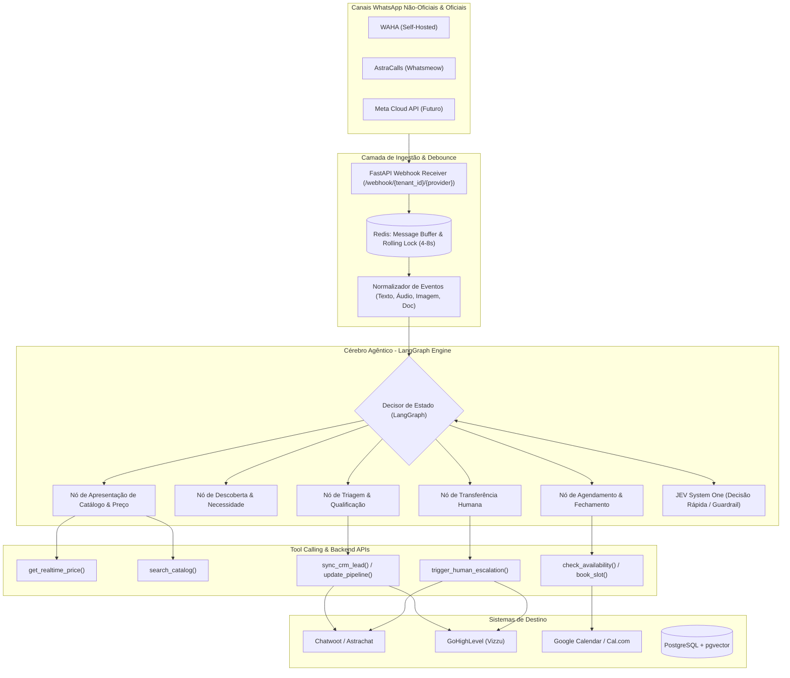

# Lobo AI Sales Agent — Arquitetura de Referência & Especificação Técnica

> **Data de Referência:** Novembro de 2026  
> **Propósito:** Motor Agêntico Autônomo Multi-tenant para Atendimento Comercial, Qualificação, Agendamento e Vendas no WhatsApp, com Handoff Humano transparente.

---

## 1. Visão Geral do Sistema

O **Lobo AI Sales Agent** é uma plataforma construída para desacoplar a inteligência de vendas dos canais de transporte (WhatsApp) e dos softwares de CRM. 

Nenhum prompt livre controla preços ou estoque. A arquitetura é baseada em um **Grafo de Estados Determinístico (LangGraph)** acoplado a **Ferramentas Tipadas (Tool Calling)** e um **Buffer Inteligente de Mensagens (Redis Debounce)**.



---

## 2. Pilha Tecnológica (Tech Stack)

| Componente | Tecnologia Selecionada | Motivação |
| :--- | :--- | :--- |
| **Backend & Webhooks** | **Python 3.11+ / FastAPI** | Alto desempenho assíncrono (`asyncio`), tipagem forte Pydantic v2, ecossistema nativo de IA. |
| **Orquestração Agêntica** | **LangGraph (LangChain Python)** | Licença MIT, persistência de grafos cíclicos, controle rígido de transições e rollback de estado. |
| **Buffer & Debounce** | **Redis 7.x** | In-memory queues, locks atômicos (`SETNX`), expiração automática (`EXPIRE`), debounce rolling window. |
| **Banco Relacional & Vetores** | **PostgreSQL 16 + pgvector** | Multi-tenancy, histórico de mensagens, auditoria de tool calls e RAG de documentos/políticas. |
| **Modelo Principal de Conversa** | **Google Gemini 2.5 / 3.8 Flash** | Janela de contexto massiva, multimodal nativo, latência ultrabaixa e chamada de funções precisa. |
| **Transcrição de Voz (STT)** | **Gemini 2.5/3.5 Transcribe ou Whisper-1** | Transcrição fiel do português brasileiro com gírias e sotaques regionais. |
| **Motor de Decisão Auxiliar** | **Jev AI (System One / TypeSafe)** | Classificação rápida de intenções, scores de fechamento e detecção de emergências. |

---

## 3. O Ciclo de Vida do Debounce de Mensagens (Buffer do WhatsApp)

O comportamento natural do lead é fragmentar pensamentos em várias mensagens seguidas.

```
Tempo (s)    Ação do Lead                        Ação do Sistema
-----------------------------------------------------------------------------------------
00:00:01     "Olá, boa tarde"                   Recebe no Webhook -> Salva no Redis buffer -> Seta TTL = 4s
00:00:02     "Quero saber o valor do colchão"   Recebe no Webhook -> Adiciona ao buffer -> Reinicia TTL = 4s
00:00:04     "Modelo King com molas ensacadas"  Recebe no Webhook -> Adiciona ao buffer -> Reinicia TTL = 4s
00:00:08     [Silêncio do Lead atingido]         TTL expira -> Lock atômico adquirido -> Concatena buffer
00:00:08.2   Dispara "composing" (digitando...) para o WhatsApp via WAHA/AstraCalls
00:00:09.5   LangGraph processa o bloco único -> Chama ferramenta de catálogo -> Envia resposta única
```

- **Janela de silêncio:** 4 segundos configurável por tenant.
- **Teto máximo de segurança:** 10 segundos (mesmo que o lead continue digitando sem parar, o lote é fechado e processado).

---

## 4. O Grafo de Estados (LangGraph State Machine)

O atendimento segue um grafo rígido de nós:

1. **`node_triage`:**
   - Identifica quem é o lead (novo vs. recorrente).
   - Verifica se a conversa já está sob controle de um atendente humano (`human_active`). Se sim, a IA silencia imediatamente.
2. **`node_discovery`:**
   - Faz perguntas abertas e empáticas para mapear a dor.
   - *Exemplo Vizzu:* "Você busca para adulto ou infantil? É para terapia regular ou avaliação neuropsicológica?".
   - *Exemplo Colchão:* "Você prefere algo mais firme para coluna ou mais macio?".
3. **`node_offer_catalog`:**
   - Invoca `search_catalog()` e `get_realtime_price()`.
   - **Regra:** Nunca expõe preços sem antes ter o retorno validado da ferramenta.
4. **`node_booking_conversion`:**
   - Consulta `check_availability()` na agenda do cliente.
   - Oferece sempre 2 opções de datas/horários concretos.
   - Se o lead confirmar, invoca `create_appointment()`.
5. **`node_handoff`:**
   - Disparado se:
     a) O lead solicitar falar com uma pessoa;
     b) A dúvida não constar na base e exigir validação humana;
     c) Ocorrer uma negociação de desconto fora da tabela autorizada;
     d) Emergência clínica detectada (Vizzu).
   - Ação: Envia nota interna privada no Chatwoot/GHL com resumo executivo, altera tag para `atendimento_humano` e avisa o lead cordialmente.

---

## 5. Ferramentas Tipadas do Agente (Contratos JSON/Pydantic)

As ferramentas disponíveis para o modelo executar:

```python
class BusinessInfoInput(BaseModel):
    tenant_id: str
    info_type: Literal["hours", "location", "warranty", "payment_methods"]

class CatalogSearchInput(BaseModel):
    tenant_id: str
    category: str
    keywords: list[str]

class PriceQueryInput(BaseModel):
    tenant_id: str
    item_id: str
    variant: Optional[str] = None

class AvailabilityInput(BaseModel):
    tenant_id: str
    service_id: str
    start_date: str
    end_date: str

class BookingInput(BaseModel):
    tenant_id: str
    lead_phone: str
    lead_name: str
    service_id: str
    slot_datetime: str

class HandoffInput(BaseModel):
    tenant_id: str
    lead_phone: str
    reason: str
    conversation_summary: str
    suggested_action: str
```

---

## 6. Governança e Regras Anti-Alucinação

1. **Zero Confiança em Memória Numérica:** Preços, estoque e datas de agendamento NUNCA são informados de cabeça pelo LLM. Se a tool não retornar o valor exato, o agente não chuta.
2. **Isolamento Multi-tenant Rigoroso:** Cada requisição carrega `tenant_id` validado. Os dados de um cliente (Vizzu) jamais se misturam com outro (Companhia dos Sonhos).
3. **Persistência de Auditoria:** Cada chamada de ferramenta, resposta do Gemini e decisão do JEV é gravada no PostgreSQL com timestamp, payload e latência.
