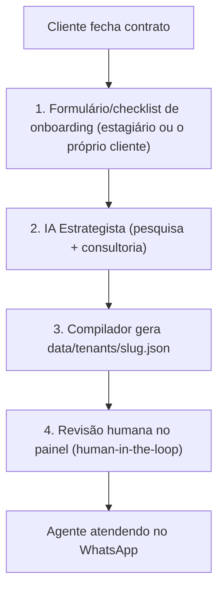

# Roadmap — Onboarding Automatizado de Clientes com IA Estrategista

> Status: **planejado** (registrado em 11/11/2026 a pedido do Danyllo). Implementar depois que o agente estiver validado com os primeiros clientes reais.

## Objetivo
Fechou contrato (ex.: uma barbearia pagou a implantação ou os 50% de entrada) → um estagiário faz uma coleta guiada → uma IA estrategista monta **todo o tenant**: System Prompt (Camadas 2 e 3), dados da empresa, catálogo com preços, segmento, frete/bairros, agenda e playbook de vendas etapa por etapa.

## Fluxo

## 1. Formulário / checklist (pensado para quem não é técnico)
Cada campo marcado como **[obrigatório]** ou **[recomendado]**, com exemplo de resposta.

- **Bloco A: Empresa.** Nome comercial, Instagram/site, endereço com ponto de referência, horário, cidades e bairros atendidos, política de entrega ou deslocamento, retirada na loja.
- **Bloco B: Catálogo e preços.** Tabela de produtos/serviços (aceita foto/PDF da tabela), formas de pagamento (Pix com desconto, parcelas sem juros), carros-chefe, itens sem estoque, fotos/vídeos por produto.
- **Bloco C: Regras comerciais.** Duração de cada serviço, horários livres, política de cancelamento, descontos autorizados (alçada do vendedor e do gerente), quem recebe o handoff.
- **Bloco D: Dores e objeções.** As 3 perguntas mais comuns no WhatsApp, o que o cliente diz quando não fecha ("tá caro", "vou ver com minha esposa"), 2 a 3 concorrentes da região, diferenciais reais.
- **Checklist de entregáveis do cliente:** logo, tabela de preços atualizada, mídias dos produtos, acesso ao WhatsApp/CRM, número do responsável pelo handoff.

## 2. IA Estrategista de Setup (modelo de raciocínio + busca na web)
Não é o agente de vendas (que precisa responder em segundos). É um agente "pesado", executado uma vez por cliente:

1. **Pesquisa de mercado e concorrência local** (Google/Instagram/Maps do nicho na cidade/bairro).
2. **PCI e persona:** perfil de cliente ideal, níveis de consciência, gatilhos de compra.
3. **Tom de voz e posicionamento do vendedor** ("Sou o consultor de estilo da Barbearia X").
4. **Mapa de objeções com respostas** baseadas nos diferenciais reais informados.
5. **Funil etapa por etapa:** acolhimento, descoberta, apresentação, objeções, fechamento, follow-up.
6. **Estruturação de dados:** catálogo (preço, parcelas, atributos, estoque), serviços de agenda com duração, zonas de entrega e gazetteer de bairros (`delivery.neighborhoods`).

## 3. Compilador do tenant
Gera o JSON validado pelo Pydantic (`TenantData`), incluindo:
- `tenant.playbook_override` (Camada 2 personalizada) e `tenant.custom_instructions` (Camada 3);
- `catalog`, `delivery` (zonas, `neighborhoods`, `region_hint`), `business_info`, `calendar`;
- régua de follow-up adequada ao nicho.

## 4. Revisão humana no painel
Tela de diff ("o que a IA gerou" × "padrão"), com o prompt compilado visível. O gestor aprova e clica em **Ativar cliente**. A Camada 1 (Kernel global de governança) **nunca** é gerada nem editada pelo onboarding.

## Pré-requisitos já entregues
- Kernel global agnóstico de nicho (Camada 1) separado de playbook (Camada 2) e DNA do cliente (Camada 3).
- Editor de prompt por cliente no painel, com confirmação e backup de versões.
- Geolocalização genérica (zonas, gazetteer por cliente, CEP via ViaCEP, geocodificação OpenStreetMap).

